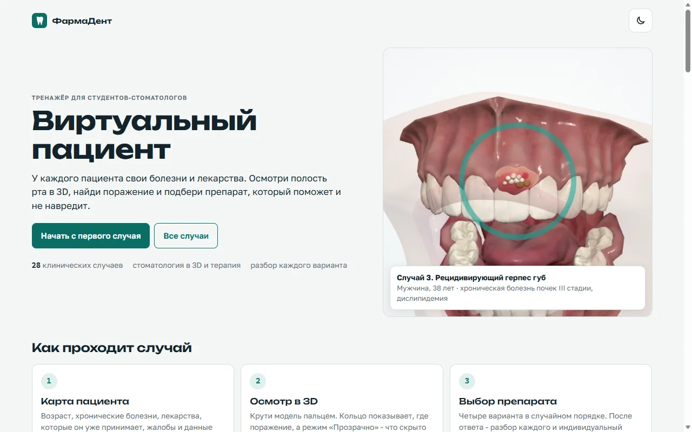
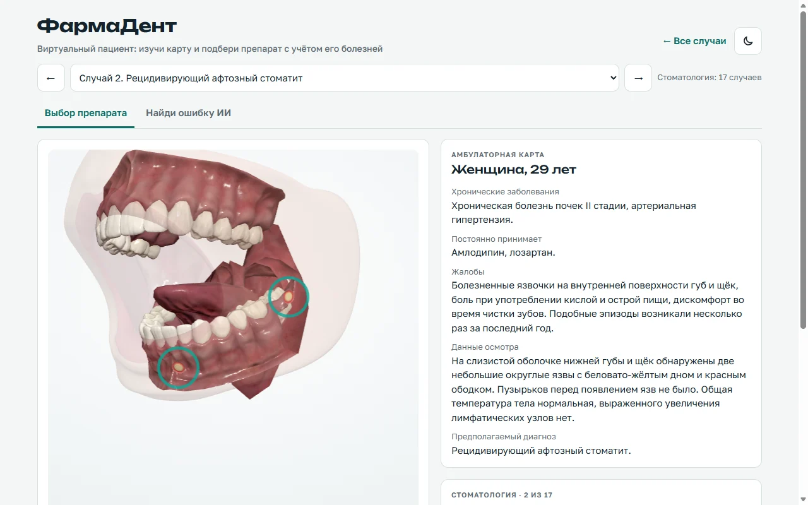
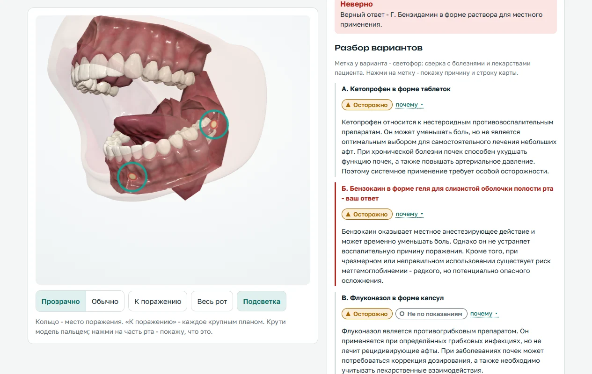
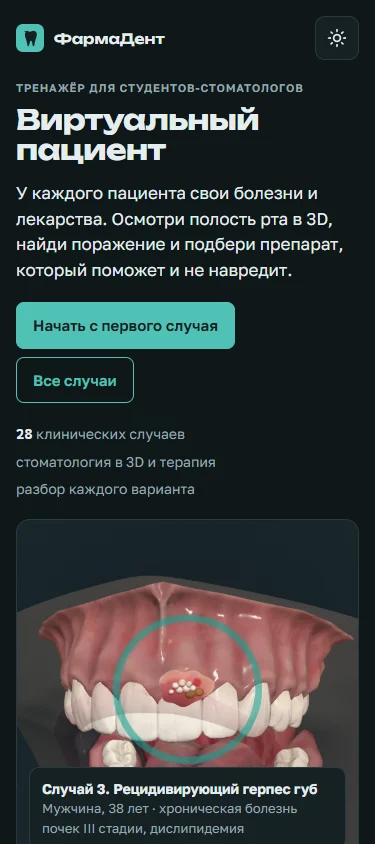
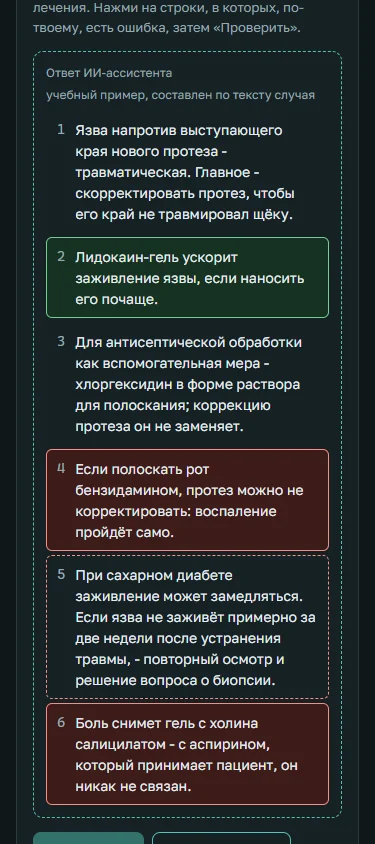

<div align="center">


# ФармаДент

**Виртуальный пациент для студентов-стоматологов.**<br>
Осмотри полость рта в 3D, найди поражение и подбери препарат, который поможет и не навредит.

<a href="https://welut-cor.github.io/pharmadent/"></a>


<br><br>



</div>

---

## Что это

Тренажёр по фармакологии в стоматологии. У каждого пациента свой возраст, свои хронические болезни и лекарства, которые он уже принимает. Студент читает карту, осматривает поражение на 3D-модели и выбирает препарат из четырёх вариантов. Верный ответ - тот, что подходит именно этому пациенту, а не «вообще от этой болезни».

Сделан для конкурса кафедры фармакологии ЧГУ [«Pharmacologia Dentalis: ИИ-помощник студента»](https://pharm-chuvsu.ru/?p=6512).

| | |
|---|---|
| 🦷 **17 стоматологических случаев** | афты, герпес, кандидоз, красный плоский лишай, травматическая язва и другие - каждый с 3D |
| 🩺 **11 терапевтических случаев** | вместо 3D - схема тела |
| 🔍 **«Найди ошибку ИИ»** | разбор уверенного, но местами опасного плана лечения |
| 🚦 **Светофор препаратов** | сверка каждого варианта с болезнями и лекарствами пациента |

## Как проходит случай

<table>
<tr>
<td width="50%" valign="top">

**1. Карта пациента.** Возраст, хронические болезни, лекарства, жалобы и данные осмотра.

**2. Осмотр в 3D.** Модель крутится пальцем или мышью. Кольцо показывает, где поражение, «К поражению» подводит камеру к каждому крупным планом, а режим «Прозрачно» показывает, что скрыто за губами и щеками.

</td>
<td width="50%" valign="top">

**3. Выбор препарата.** Четыре варианта в случайном порядке. После ответа - разбор каждого варианта и подход к этому пациенту.

**4. Найди ошибку ИИ.** ИИ-ассистент отвечает уверенно, даже когда ошибается. Нужно отметить строки с ошибками, а разбор покажет, чем они опасны для этого пациента.

</td>
</tr>
</table>

<div align="center">

</div>

### Разбор и светофор

После ответа у каждого варианта появляется метка: **Конфликт** (с болезнью или лекарством пациента), **Осторожно**, **Не по показаниям**, **Подходит** или **Правил нет**. Нажатие на метку показывает причину, подсвечивает нужную строку карты и называет источник.

<div align="center">

</div>

### На телефоне

Сайт сделан под телефон: на нём его и откроют на занятии. Есть светлая и тёмная тема, а после первого захода сайт работает без интернета.

<div align="center">

&nbsp;&nbsp;&nbsp;

</div>

## Устройство

Обычный статический сайт: HTML, CSS и JavaScript без фреймворков и без сборки. Достаточно отдать папку любым веб-сервером.

```
index.html          главная: о тренажёре, карточки случаев
sluchay.html        случай: карта, 3D, выбор препарата, «Найди ошибку ИИ»
3d/prosmotr.js      3D-просмотрщик на three.js
models/             модель полости рта в GLB (сжата meshopt, ~2 МБ)
data/sluchai.js     случаи (собираются из JSON)
data/svetofor.js    правила светофора: группы препаратов × состояния пациента
sw.js               кэш для работы без сети
kartinki/           кадры 3D для карточек случаев
vendor/             three.js и шрифты - локально, без внешних CDN
```

Запустить у себя:

```bash
git clone https://github.com/Welut-cor/pharmadent.git
cd pharmadent
python -m http.server 8000
# открыть http://localhost:8000
```

> Открывать через сервер, а не двойным щелчком по файлу: из `file://` браузер не загрузит 3D-модель.

## Разработка

Авторы проекта на конкурсе - студентки-стоматологи, сайт сделали:


- **Эмиль** - [@Welut-cor](https://github.com/Welut-cor)
- **Евгений Якимов** - [@yakimov-med](https://github.com/yakimov-med)

## Лицензии

Материалы сайта: © 2026, все права защищены (см. [LICENSE](LICENSE)).

Сторонние части:

- 3D-модель основана на «Human mouth detailed», автор **Mince**, лицензия [CC BY 4.0](https://creativecommons.org/licenses/by/4.0/), с изменениями.
- [three.js](https://threejs.org/) r186 - лицензия MIT.
- Шрифты Golos Text и Unbounded - лицензия SIL Open Font License.

<div align="center"><br><sub>Сайт - учебный тренажёр и не заменяет назначение врача.</sub></div>
